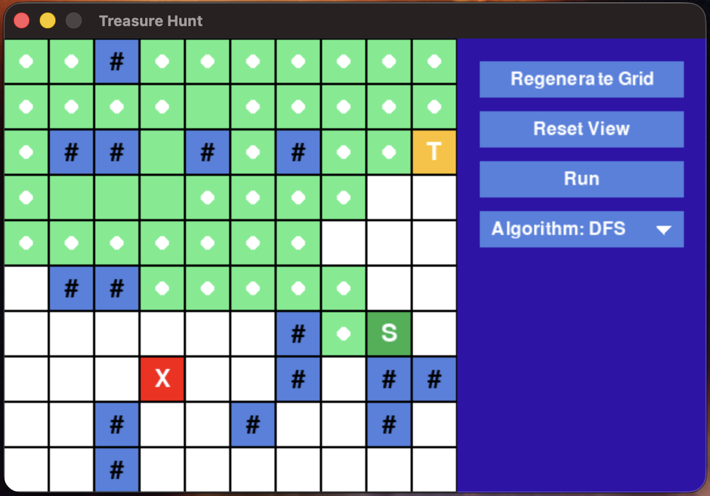
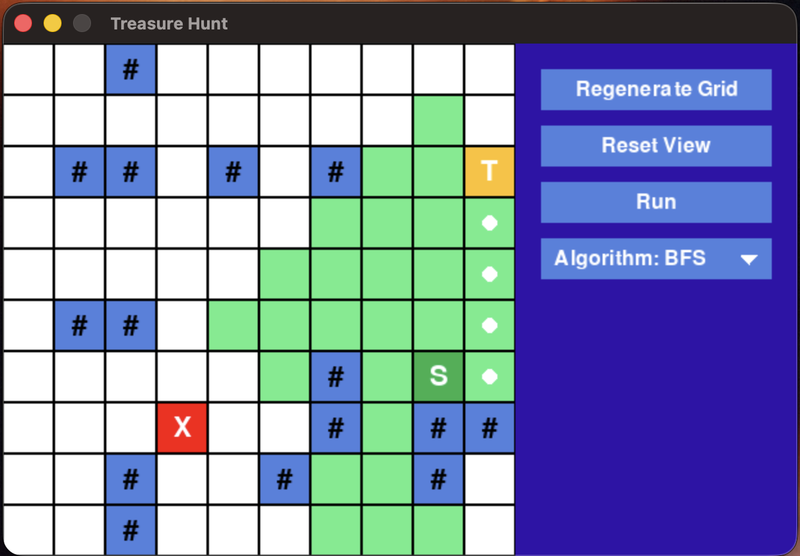
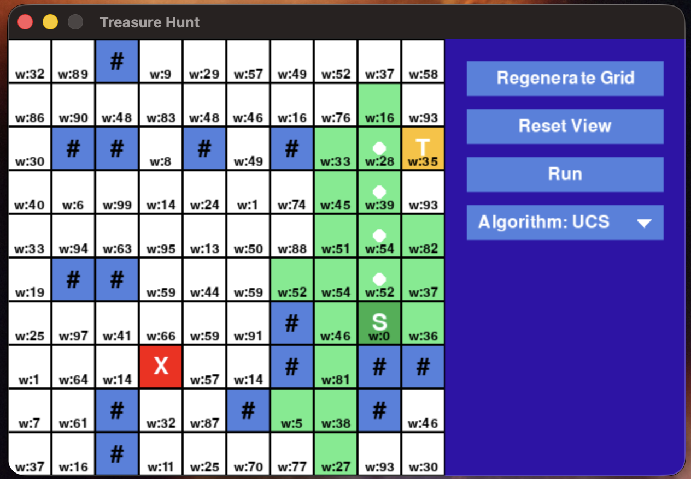
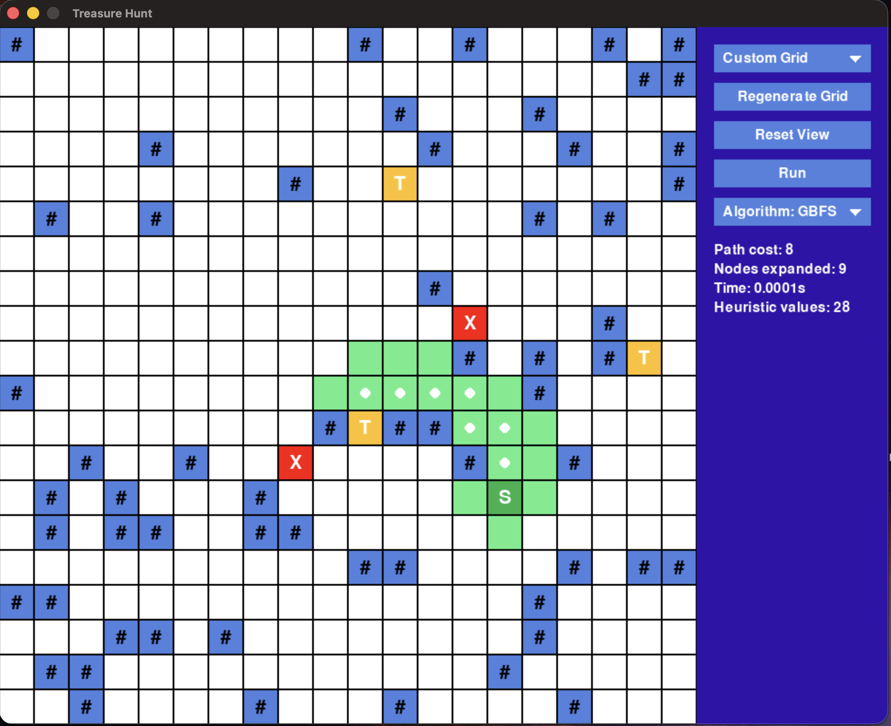
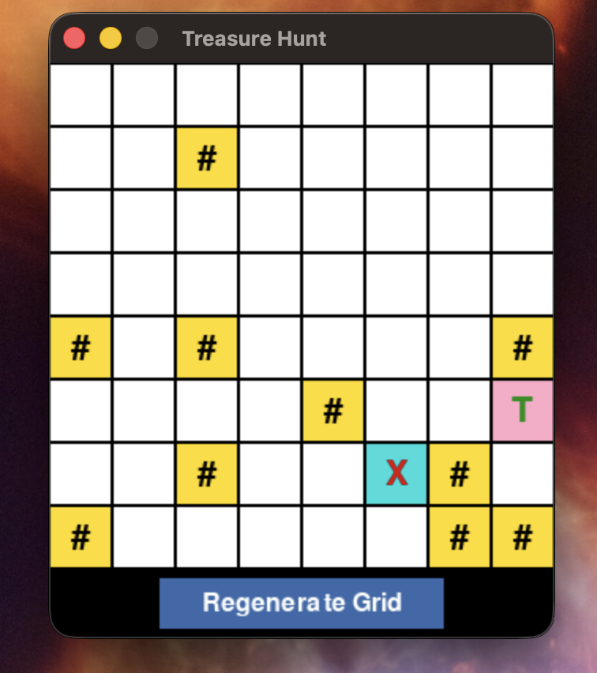
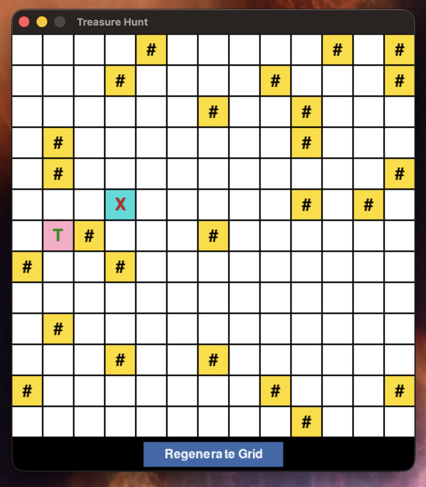
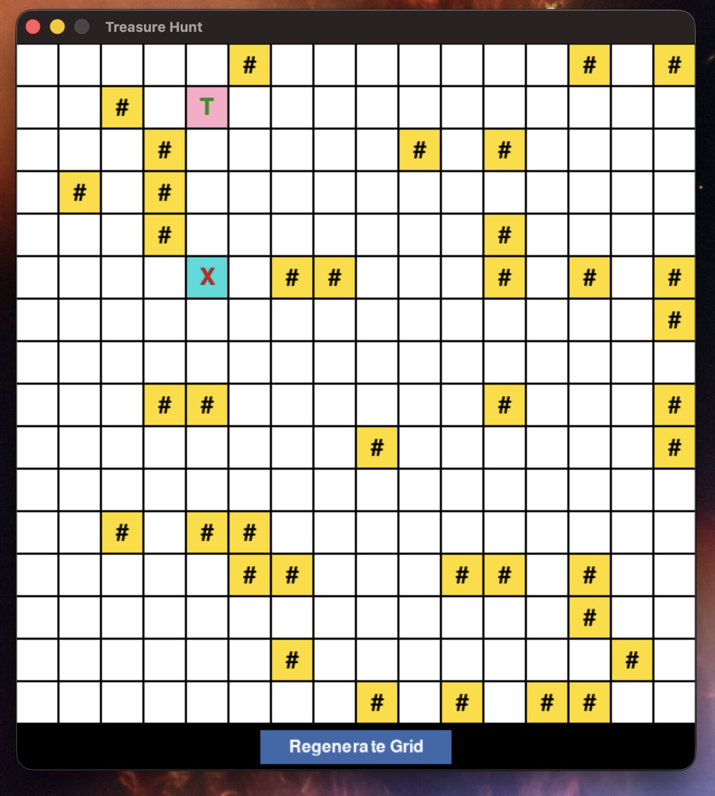

# TresureHunt
This is for TCSS 435 AI

## Quick start

Needs **Python 3.10 or newer**. From the project folder:

```bash
python3 -m venv .venv                      # Windows: py -m venv .venv
source .venv/bin/activate                  # Windows: .venv\Scripts\activate
python -m pip install -r requirements.txt
python main.py
```

If `python3 --version` is older than 3.10, create the environment with a newer interpreter instead (for example `python3.13 -m venv .venv`). More detail is in the setup sections below.

In the window, choose an algorithm from the **Algorithm** dropdown, click **Run**, and read the report in the terminal.

## Grid generation

Each run creates a random 20x20 map (`GRID_SIZE` in `main.py`). 15 % of its cells are static walls, and each map also has one start, **two traps** and **three treasures**. A search is finished when it reaches *any* of the treasures. Select **Regenerate Grid** to generate a new map.

**Traps on this random map are blocked, like walls, for all five algorithms.** They never appear on a path, are never visited, and show no weight.

Use the **Custom Grid** dropdown to load either of the two hand-made maps in `custom_grids/`. Each JSON file has a display name and ten rows using `S` for the start, `T` for treasure, `X` for a trap, `#` for a wall, and `.` for an empty cell, with exactly one start and one treasure. **On custom grids, UCS and A* may walk through a trap at a fixed cost of 6** (the trap shows `6`), while DFS, BFS and GBFS still treat traps as walls, so the five searches do not follow the same rules there. Custom grids are otherwise unchanged: every open cell costs 1, and A* still uses that weight matrix there. The standalone `python custom_grid.py` window behaves the same way.

## Using the window

- **Run** plays the search as an animation: green cells are the ones reached, then white dots trace the path.
- While the animation plays, every sidebar button is dimmed and ignores clicks. Clicking on the grid, or pressing a key, skips the rest of the animation.
- When it ends, the buttons return to normal and the results (path cost, nodes expanded, time) appear.
- The results text is cleared the moment you click **Run**, switch algorithm (picking the same one again changes nothing), click **Regenerate Grid**, load a **Custom Grid**, or click **Reset View**.
- Press **G** to toggle the grid lines.

## Algorithms

Choose an algorithm from the **Algorithm** dropdown in the sidebar, then click **Run**. Green cells are the cells the search reached and the white dots mark the path it found.

All five searches share one interface (`algos/search_algo.py`): `search(grid, start_row, start_col)` returns the parent of every cell it reached, the treasure's location (`()` if it cannot be reached) and the number of nodes expanded. UCS and A* also return their total cost; DFS, BFS and GBFS do not, so the GUI counts their steps. `agents.py` rebuilds the path by following the parents from the treasure back to the start. Searches cannot step on a wall (`#`) or off the grid. They also cannot step on a trap (`X`), except that UCS and A* may enter one at its fixed cost of 6 when constructed with `unusual_costs=True`. The default is `unusual_costs=False` (blocked), and only the custom grids turn it on.

The screenshots and console outputs for DFS, BFS and UCS below all come from the same older 10x10 map with a single treasure and one trap: `S` (green) is the start, `T` (gold) the treasure, `#` (blue) a wall and `X` (red) the trap. They were taken before the changes above, so the UCS screenshot still shows `w:number` labels and random weights.

### DFS (depth-first search, `algos/dfs.py`)

- It uses a stack of `(cell, parent)` pairs. A cell is marked visited when it is **popped**, not when it is pushed. The same cell can sit on the stack more than once, and a copy popped after the cell is already visited is skipped.
- The last neighbor pushed is the first one popped, so it explores left, up, right, then down, going as deep as it can before backing up.
- It stops when it pops the treasure. The path it returns is simply the first one it found, not the shortest: 41 steps below, where BFS needs 5.



```
=== DFS ===
Coordinates are (row, col), counted from 0 at the top left corner.
w is the cost of stepping onto a cell (always 1 for DFS and BFS); total is the cost so far.
(6, 8) w:0 -> total 0
(6, 7) w:1 -> total 1
(5, 7) w:1 -> total 2
(5, 6) w:1 -> total 3
(5, 5) w:1 -> total 4
(5, 4) w:1 -> total 5
(5, 3) w:1 -> total 6
(4, 3) w:1 -> total 7
(4, 2) w:1 -> total 8
(4, 1) w:1 -> total 9
(4, 0) w:1 -> total 10
(3, 0) w:1 -> total 11
(2, 0) w:1 -> total 12
(1, 0) w:1 -> total 13
(0, 0) w:1 -> total 14
(0, 1) w:1 -> total 15
(1, 1) w:1 -> total 16
(1, 2) w:1 -> total 17
(1, 3) w:1 -> total 18
(0, 3) w:1 -> total 19
(0, 4) w:1 -> total 20
(0, 5) w:1 -> total 21
(0, 6) w:1 -> total 22
(0, 7) w:1 -> total 23
(0, 8) w:1 -> total 24
(0, 9) w:1 -> total 25
(1, 9) w:1 -> total 26
(1, 8) w:1 -> total 27
(1, 7) w:1 -> total 28
(1, 6) w:1 -> total 29
(1, 5) w:1 -> total 30
(2, 5) w:1 -> total 31
(3, 5) w:1 -> total 32
(3, 4) w:1 -> total 33
(4, 4) w:1 -> total 34
(4, 5) w:1 -> total 35
(4, 6) w:1 -> total 36
(3, 6) w:1 -> total 37
(3, 7) w:1 -> total 38
(2, 7) w:1 -> total 39
(2, 8) w:1 -> total 40
(2, 9) w:1 -> total 41
Path cost: 41
Nodes expanded: 47
Runtime: 0.000114 seconds
```

### BFS (breadth-first search, `algos/bfs.py`)

- It uses a queue and works level by level: every cell 1 step away, then every cell 2 steps away, and so on. A cell is marked when it is **queued**, so each cell is queued once and its parent is recorded at that moment.
- Because a whole level is finished before the next starts, the first time it reaches the treasure is by a path with the fewest steps.
- Nodes expanded counts each cell taken off the queue. Cells that were queued but never taken off still show green, so the green area can be a little bigger than the expanded count.



```
=== BFS ===
Coordinates are (row, col), counted from 0 at the top left corner.
w is the cost of stepping onto a cell (always 1 for DFS and BFS); total is the cost so far.
(6, 8) w:0 -> total 0
(6, 9) w:1 -> total 1
(5, 9) w:1 -> total 2
(4, 9) w:1 -> total 3
(3, 9) w:1 -> total 4
(2, 9) w:1 -> total 5
Path cost: 5
Nodes expanded: 21
Runtime: 0.000060 seconds
```

### UCS (uniform cost search, `algos/ucs.py`)

- UCS uses step costs. Choosing UCS lays a weight matrix over the current map and draws just the number in each cell (the terminal report still writes `w:number`). **UCS is the only search with random weights, and only on the random map**: each empty cell gets a random cost from 1 to 99 (`MIN_WEIGHT` and `MAX_WEIGHT` in `grid.py`), the treasure costs 1, the start costs 0, and walls and traps have no weight (traps are blocked there). On custom grids the matrix is constant instead: every open cell and the treasure cost 1, the start 0, and traps 6 (passable). Choosing UCS again in the dropdown, or clicking **Regenerate Grid** while UCS is selected, rolls a new matrix, and switching away from UCS removes it. DFS, BFS and GBFS never see weights, and A* sees them on custom grids only.
- It uses a priority queue (min-heap) ordered by the cost so far, then row, then column. A cell is marked visited when it is **popped**, because the first time a cell is popped it was reached by its cheapest route. Later, more expensive copies are skipped.
- It returns the cheapest path, which is not always the one with the fewest steps. Below, UCS and BFS both take 5 steps, but UCS's route costs 208 while BFS's route (straight up the right edge) would cost 283 with these weights. When a cheaper route is longer, UCS takes it; the UCS unit tests cover that case.
- It checks its weights before searching and raises a `ValueError` if they do not match the grid, if a weight below 1 is found (the start is the only 0), if a wall has a weight, or if a trap's weight disagrees with the mode: a blocked trap (`unusual_costs=False`) must have no weight, and a passable one (`unusual_costs=True`) must cost exactly 6.



```
=== UCS ===
Coordinates are (row, col), counted from 0 at the top left corner.
w is the cost of stepping onto a cell (always 1 for DFS and BFS); total is the cost so far.
(6, 8) w:0 -> total 0
(5, 8) w:52 -> total 52
(4, 8) w:54 -> total 106
(3, 8) w:39 -> total 145
(2, 8) w:28 -> total 173
(2, 9) w:35 -> total 208
Path cost: 208
Nodes expanded: 20
Runtime: 0.000082 seconds
```

### A* (`algos/astar.py`)

- It uses a priority queue ordered by `f = g + h`, where `g` is the cost so far and `h` is a guess of the cost still to go. **On the random map every step costs 1, so `g` is just the number of steps and there are no weights to show.** On custom grids it keeps the weight matrix described above (every open cell 1, passable traps 6), as before.
- The map has several treasures, so `h` is the Manhattan distance (rows plus columns) to the **nearest** treasure. A* finds the treasures by scanning the grid it is given, so it cannot disagree with the map. That `h` never overestimates the cost to the closest treasure and is 0 on every treasure, so A* returns a shortest path, the same length as BFS, with fewer expanded cells: on 1997 solvable random 20x20 maps it expanded fewer cells than BFS on 1981 and never more, averaging 22 against BFS's 85.

A* on a random 20x20 map (three treasures, two traps): it took the shortest route to the nearest treasure (path cost 6) after expanding 12 cells.


Console output for an 8x4 map with a treasure at the top left (cost 5) and another at the bottom right (farther away); with every open cell costing 1:

```
=== A* ===
Coordinates are (row, col), counted from 0 at the top left corner.
w is the cost of stepping onto a cell (always 1 for DFS and BFS); total is the cost so far.
(2, 3) w:0 -> total 0
(2, 2) w:1 -> total 1
(1, 2) w:1 -> total 2
(0, 2) w:1 -> total 3
(0, 1) w:1 -> total 4
(0, 0) w:1 -> total 5
h of each expanded cell, in the order they were expanded:
h(2, 3) = 5
h(2, 2) = 4
h(2, 4) = 4
h(1, 2) = 3
h(2, 1) = 3
h(2, 5) = 3
h(3, 4) = 3
h(0, 2) = 2
h(2, 0) = 2
h(3, 5) = 2
h(0, 1) = 1
h(1, 0) = 1
h(0, 0) = 0
Heuristic values: 33
Path cost: 5
Nodes expanded: 13
Runtime: 0.000034 seconds
```

### GBFS (greedy best-first search, `algos/gbfs.py`)

- It is A* without `g`. It uses a priority queue ordered **only** by `h`, the Manhattan distance to the nearest treasure, and never looks at how far it has already walked. It expands the cell that looks closest to a treasure.
- Ties in `h` are broken by the smaller `row + col`, then the smaller `row`, so a run is always the same. Tied cells can sit on opposite sides of a treasure, where `row + col` and `row` disagree, so both keys matter. `tests/test_gbfs.py` pins the order.
- A cell is marked when it is first queued (like BFS), which is also when its parent is recorded. It stops when it pops a treasure, and treats walls and traps as impassable. It raises a `ValueError` if the grid has no treasure or no start.
- It is fast but **not optimal**. On 1997 solvable random 20x20 maps it expanded 11 cells on average (BFS: 85), but its path was longer than BFS's on 335 of them (17 %), by 2.7 extra steps on average and up to 14. It finds a path exactly when BFS does, since it never revisits a cell.

GBFS on the **same** 20x20 map as the A* screenshot above. It reaches the same treasure but approaches it from above, along a longer route (path cost 8 against A*'s 6), and it expands fewer cells (9 against 12) and has a smaller heuristic sum (28 against 38). That is the tradeoff in one picture: greedy does less work and can pay for it with a worse path.



On this 6x5 map `T` sits right under a pair of walls, so greedy marches toward it, runs into the pocket above it, and has to come back around, while BFS goes straight around the walls. The map is `..#S..` / `......` / `......` / `....##` / `.....T`.

```
=== GBFS ===
Coordinates are (row, col), counted from 0 at the top left corner.
w is the cost of stepping onto a cell (always 1 for DFS and BFS); total is the cost so far.
(0, 3) w:0 -> total 0
(0, 4) w:1 -> total 1
(0, 5) w:1 -> total 2
(1, 5) w:1 -> total 3
(2, 5) w:1 -> total 4
(2, 4) w:1 -> total 5
(2, 3) w:1 -> total 6
(3, 3) w:1 -> total 7
(4, 3) w:1 -> total 8
(4, 4) w:1 -> total 9
(4, 5) w:1 -> total 10
h of each expanded cell, in the order they were expanded:
h(0, 3) = 6
h(0, 4) = 5
h(0, 5) = 4
h(1, 5) = 3
h(2, 5) = 2
h(2, 4) = 3
h(1, 4) = 4
h(2, 3) = 4
h(3, 3) = 3
h(4, 3) = 2
h(4, 4) = 1
h(4, 5) = 0
Heuristic values: 37
Path cost: 10
Nodes expanded: 12
Runtime: 0.000019 seconds
```

BFS on the same map takes 6 steps (path cost 6) but expands 24 cells.

### Reading the output

- Each path line is one cell: its `(row, col)`, the cost of stepping onto it, and the cost so far. The start costs 0, and DFS and BFS charge 1 per step.
- **Path cost** is the total cost of the path (`n/a` when the treasure cannot be reached, which also prints `No path to the treasure`).
- **Nodes expanded** is how many cells the search took off its frontier and expanded, counting the treasure cell when it is reached. It is not the same as the path length.
- **Heuristic values** (A* and GBFS only): the console lists `h` for every cell the search expanded, in the order it expanded them, one line each, so there are exactly as many lines as *Nodes expanded*. `h` is the Manhattan distance to the nearest treasure, so the treasure's own line is always `h = 0`. The line `Heuristic values: N` is the sum of them, and the window shows the same `Heuristic values: N` under the stats once the animation finishes. It is also reported when no path is found. DFS, BFS and UCS print and show nothing for it. The sum grows with the number of expanded cells, so it is most useful for comparing two runs on the same map.
- **Runtime** is the time spent inside the search, in seconds. Runtimes change from run to run.

## Sample Grid

Example 1:



Example 2:



Example 3:



## Requirements

**Python 3.10 or newer** (developed on 3.13). The code uses the `X | Y` type-union syntax, which raises a `TypeError` on Python 3.9 and older. Check your version with:

```bash
python3 --version   # macOS / Linux
py --version        # Windows
```

If it is older than 3.10, install a newer Python from [python.org](https://www.python.org/downloads/) (or `brew install python@3.13` on macOS) before continuing. The `.python-version` file records the version the project was developed with, for tools like `pyenv` and `uv`.

## Set up the virtual environment

Run these commands from the project folder. A virtual environment is tied to the Python that created it, so create it with a 3.10+ interpreter. If you have an old `.venv` from an older Python, delete it first (`rm -rf .venv` on macOS, `rmdir /s /q .venv` on Windows).

### Windows

Create the environment:

```powershell
py -3.13 -m venv .venv
```

Use any installed 3.10+ version in place of `3.13`.

Activate it in PowerShell:

```powershell
.\.venv\Scripts\Activate.ps1
```

Or activate it in Command Prompt:

```bat
.venv\Scripts\activate.bat
```

### macOS

Create the environment:

```bash
python3.13 -m venv .venv
```

Use `python3` instead if `python3 --version` already reports 3.10 or newer, or substitute any installed 3.10+ version for `3.13`.

Activate it:

```bash
source .venv/bin/activate
```

### Install dependencies

With the virtual environment activated, install the dependencies (Pygame) listed in `requirements.txt`:

```sh
python -m pip install -r requirements.txt
```

### Run the game

From the project folder, with the virtual environment activated, run:

```sh
python main.py
```

### Run the tests (optional)

The tests are only for development, so they have their own requirements file and the game does not need them. With the virtual environment activated:

```sh
python -m pip install -r requirements-dev.txt
python -m pytest
```

There is one test file per search in `tests/` (`test_dfs.py`, `test_bfs.py`, `test_ucs.py`, `test_astar.py`, `test_gbfs.py`), `test_heuristic_values.py` (one value per expanded cell, each equal to `h`, in the report and the sum), plus `test_traps.py` (traps are blocked by every algorithm on random maps and the weight matrix has no trap weights), `test_weights.py` (the random 1 to 99 weights touch only empty cells) and two files for the custom grids.

To exit the environment on either platform, run:

```bash
deactivate
```

### Generative AI Statement

Abdulrahman Elmi: I utilized Claude to assist me on working on my parts. I was responsible for the 10×10 change, the UCS skeleton and rename work, running the real window, taking the screenshots, and the pushes and merges. I also decided how the weights work. I ensured that the UCS followed design and look to match consistency with implementation of BFS and DFS by Yusuf.

Claude wrote the UCS search with input validation, and the w:number display in the GUI.
Claude built the algorithm dropdown and added nodes_expanded to all three searches. It also wrote the labeled console report (Path cost, Nodes expanded, Runtime). Claude wrote 9 pytest tests, 3 per search, using hand-made grids. It checked that they catch broken code by deliberately breaking each algorithm. It also wrote the README quick start and the per-algorithm notes. Claude compared the searches with independent reference implementations on thousands of random maps. It also drove the dropdown and Run flow with simulated events.
