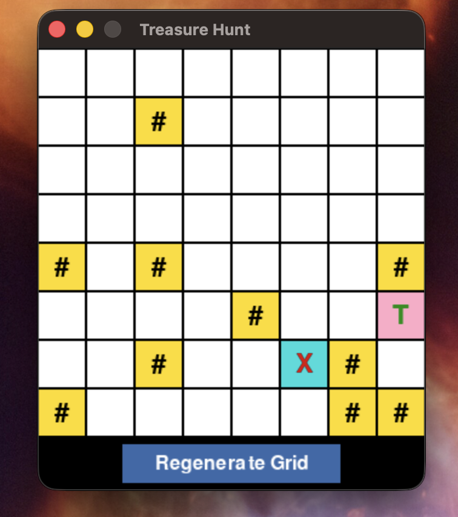
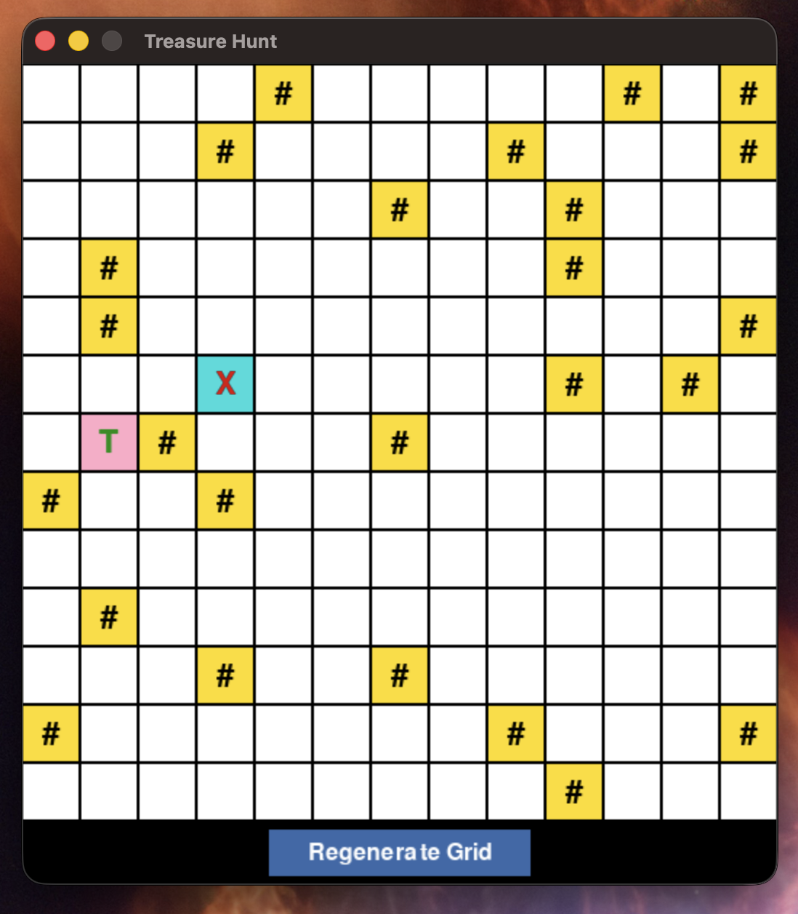
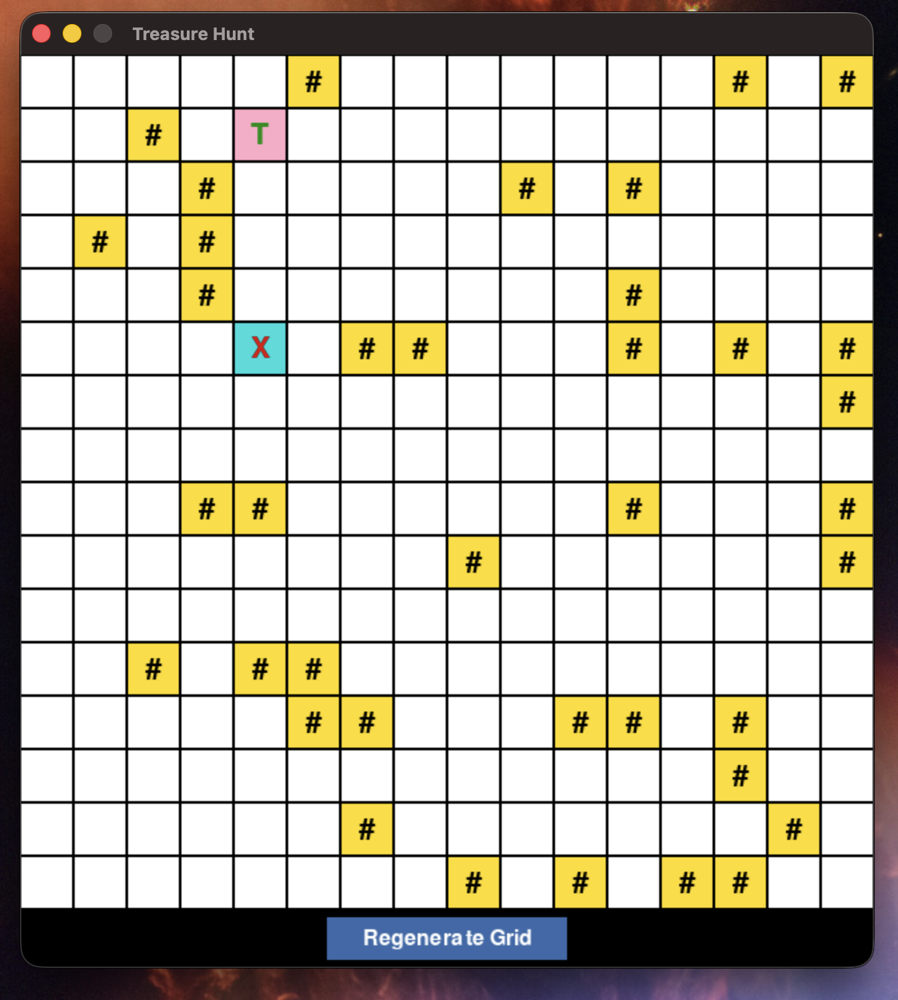

# TresureHunt
This is for TCSS 435 AI

## Grid generation

Each run creates a square map with a randomly selected side length from 8 to 16 cells. About 15% of its cells contain static walls; each map also has one trap and one treasure. Select **Regenerate Grid** below the grid to generate a new grid.

## Sample Grid

Example 1:



Example 2:



Example 3:



## Set up the virtual environment

Run these commands from the project folder. If Python is not installed, install it first.

### Windows

Create the environment:

```powershell
py -m venv .venv
```

Activate it in PowerShell:

```powershell
.\.venv\Scripts\Activate.ps1
```

Or activate it in Command Prompt:

```bat
.venv\Scripts\activate.bat
```

### macOS

Create the environment:

```bash
python3 -m venv .venv
```

Activate it:

```bash
source .venv/bin/activate
```

### Install dependencies

With the virtual environment activated, install the dependencies (Pygame) listed in `requirements.txt`:

```sh
python -m pip install -r requirements.txt
```

### Run the game

From the project folder, with the virtual environment activated, run:

```sh
python main.py
```

To exit the environment on either platform, run:

```bash
deactivate
```
